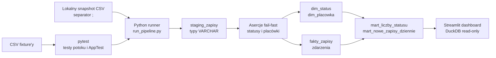

# Dokumentacja projektu — potok zapisów na kursy

## 1. Kontekst, odbiorca i pytania

### Problem i odbiorcy

Szkoła językowa chce monitorować zapisy na kursy i rozumieć ich podział na
statusy procesu sprzedaży. Głównymi odbiorcami są analityk sprzedaży oraz
menedżer odpowiedzialny za placówki. Dashboard ma pomóc ocenić skalę zapisów,
napływ w czasie i różnice pomiędzy placówkami.

### Pytania, na które odpowiadają dane

1. Ile zapisów z wybranego okresu i wybranych placówek znalazło się w każdej
   kategorii biznesowej?
2. Jak zmieniał się dzienny napływ nowych zapisów według daty utworzenia
   w Fenku?
3. Jaki jest podział zapisów między `AKTYWNY`, `ZAPISANY`, `REZYGNACJA` i
   `INNE`?
4. Jak różnią się dwie wybrane realne placówki pod względem liczby zapisów
   w tych kategoriach?
5. Jaki jest udział każdej kategorii w sumie zapisów danej placówki oraz
   różnica liczebności między placówkami?

Wartości są liczone dla aktualnego snapshotu i filtrów dashboardu. To nie jest
narzędzie do śledzenia historii zmian statusu pojedynczego zapisu.

### Perspektywa biznesowa

Rozwiązanie wspiera rozmowy o napływie zapisów, wielkości grupy `AKTYWNY`,
zapisach zakończonych sukcesem oraz rezygnacjach. Wskaźnikiem operacyjnym może
być liczba zapisów w tych kategoriach w porównywalnych okresach i placówkach.
Dashboard pozwala zobaczyć te liczby, ale nie oblicza konwersji
`AKTYWNY → ZAPISANY`: do wiarygodnej konwersji potrzebna jest historia statusów
albo jednoznaczna definicja kohorty i mianownika.

Projekt działa lokalnie i używa darmowych narzędzi open source, więc nie
wymaga opłat licencyjnych ani hostingu. Koszt zasobów istniejącego komputera
jest marginalny, lecz nie został zmierzony. Koszt pracy przy utrzymaniu nie
jest znany i powinien być oszacowany na podstawie czasu aktualizacji danych,
obsługi błędów oraz zmian schematu źródła.

### Perspektywa dziedzinowa

- Jeden zapis jest identyfikowany przez `ID zapisu`; powtórzenia wynikające
  z przypisania do wielu grup nie mają zawyżać liczebności.
- `AKTYWNY`, `ZAPISANY` i `REZYGNACJA` są kategoriami procesu sprzedaży.
- Pozostałe rozpoznane statusy należą do `tylko_filter`; dashboard pokazuje je
  zbiorczo jako `INNE`.
- `HISTORYCZNY` jest traktowany jako artefakt migracji i wyłączany z faktów.
- Oś czasu używa pola „Utworzono zapis w Fenku”, a nie „Data zapisu
  w LangLionie”. Te daty mogą się różnić, a dane mogą zawierać ich
  chronologiczne rozbieżności.
- Wymiar i dashboard rozróżniają placówki realne od technicznych i bez nazwy.
  Marty zawierają tylko realne placówki; fakt pozostaje szerszy dla audytu.

### Perspektywa techniczna

Wybrano lokalny DuckDB, bo pozwala uruchomić cały przykład bez serwera bazy,
a SQL jasno pokazuje transformacje i tabele wynikowe. Python uruchamia skrypty
SQL, wykonuje asercje i udostępnia dashboard Streamlit. Dashboard otwiera bazę
tylko do odczytu. Pełne przeładowanie jest proste i idempotentne dla małego
snapshotu, ale nie jest rozwiązaniem inkrementalnym.

Jakość i powtarzalność są wspierane przez jawne mapowanie statusów, asercje
fail-fast dla statusów i wymiaru placówek oraz testy uruchamiające potok na
kontrolowanych fixture'ach. Przy wolumenie stukrotnie większym należałoby
zmierzyć czas pełnego przeładowania i koszt pamięci. Jeśli byłyby
niewystarczające, kolejne kroki to ładowanie przyrostowe, partycjonowane
pliki Parquet, orkiestracja z logami/ponowieniami i monitorowanie jakości.
Nie ma potrzeby wprowadzać tych narzędzi przed pomiarem.

### Perspektywa prawna i etyczna

Dane wykorzystane w tym projekcie zostały udostępnione i wykorzystane 
za zezwoleniem biznesu będącego ich administratorem. Dane nie zawierają
informacji bezpośrednio identyfikujących osoby prywatne, ale przedstawiają
faktyczne dane pochodzące z procesu biznesowego.

### Automatyczne pozyskanie danych — świadome wyłączenie

Automatyczne pobieranie ze źródła zewnętrznego jest poza zakresem tej wersji.
Potok przyjmuje lokalny plik CSV, a repozytorium zawiera snapshot. Nie jest to
automatyczne pozyskanie danych w rozumieniu wymagania projektu i nie należy
przedstawiać tego jako spełnionego wymagania. Wykorzystywane dane zostały 
pozyskane jako dump systemu operacyjnego.

## 2. Architektura i przepływ danych

Źródło wejściowe to `data/zapisy_grupy_placowka.csv`. `staging_zapisy`
zachowuje typ `VARCHAR` dla pól i wykonuje ograniczoną normalizację pustych
wartości identyfikatora/nazwy placówki do `NULL`. Model transformacyjny
normalizuje zapis do faktów i zdarzeń, a marty przygotowują agregaty
konsumowane przez aplikację.

### Warstwy

| Warstwa | Obiekty | Znaczenie |
|---|---|---|
| Źródło / raw | `data/zapisy_grupy_placowka.csv`, `staging_zapisy` | Dostarczony snapshot i jego załadowane pola tekstowe. |
| Clean / model | `fakty_zapisy`, `zdarzenia`, `dim_status`, `dim_placowka` | Typowanie, deduplikacja, mapowanie statusów, unpivot zdarzeń i wymiar placówek. |
| Serving | `mart_liczby_statusu`, `mart_nowe_zapisy_dziennie` | Zmaterializowane agregaty dla analiz i dashboardu. |

## 3. Słownik danych

Wszystkie tabele są materializowane w pliku DuckDB tworzonym przez potok.
W tabelach serving placówka oznacza wyłącznie placówkę `typ='realna'`.

### `staging_zapisy`

| Kolumna | Typ | Znaczenie / źródło |
|---|---|---|
| `id_zapisu` | VARCHAR | „ID zapisu” ze źródłowego CSV. |
| `status_zapisu` | VARCHAR | „Status zapisu”. |
| `etap_zapisu` | VARCHAR | „Etap zapisu”. |
| `id_grupy` | VARCHAR | „ID grupy”. |
| `id_uslugi` | VARCHAR | „ID usługi”. |
| `rodzaj_grupy` | VARCHAR | „Rodzaj grupy”. |
| `okres_grupy` | VARCHAR | „Okres grupy”. |
| `grupa_od` | VARCHAR | „Grupa od”. |
| `grupa_do` | VARCHAR | „Grupa do”. |
| `stan_grupy` | VARCHAR | „Stan grupy”. |
| `utworzono_zapis_fenku` | VARCHAR | „Utworzono zapis w Fenku”; źródło czasu dla dziennego napływu. |
| `data_zapisu_langlionie` | VARCHAR | „Data zapisu w LangLionie”; odrębna data operacyjna. |
| `przekazano_do_dok` | VARCHAR | „Przekazano do DOK”; potencjalne zdarzenie. |
| `kliknieto_przeslano_umowe` | VARCHAR | „Kliknięto przesłano umowę”; potencjalne zdarzenie. |
| `nauczyciel_potwierdzil_realizacje` | VARCHAR | „Nauczyciel potwierdził realizację”; potencjalne zdarzenie. |
| `zrodlo_potwierdzenia_umowy` | VARCHAR | „Źródło potwierdzenia umowy”. |
| `zrodlo_potwierdzenia_nauczyciela` | VARCHAR | „Źródło potwierdzenia nauczyciela”. |
| `id_placowki` | VARCHAR | „ID placówki (z zapisu)”; pusty ciąg zamieniany na `NULL`. |
| `placowka_z_zapisu` | VARCHAR | „Placówka (z zapisu)”; pusty ciąg zamieniany na `NULL`. |

### `dim_status`

| Kolumna | Typ | Znaczenie |
|---|---|---|
| `status_zapisu` | VARCHAR | Znana wartość źródłowego statusu; klucz wymiaru. |
| `kategoria_biznesowa` | VARCHAR | `aktywny`, `zapisany`, `rezygnacja` lub `tylko_filter`. |
| `etykieta_ui` | VARCHAR | Etykieta prezentowana w aplikacji; statusy `tylko_filter` są grupowane jako `INNE`. |

### `dim_placowka`

| Kolumna | Typ | Znaczenie |
|---|---|---|
| `id_placowki` | BIGINT | Identyfikator placówki; klucz wymiaru. |
| `nazwa_wyswietlana` | VARCHAR | Nazwa do prezentacji, z normalizacją znanych wariantów nazw. |
| `typ` | VARCHAR | `realna`, `techniczna` albo `bez_nazwy`; marty filtrują do `realna`. |

### `fakty_zapisy`

Ziarnem tabeli jest jeden wiersz na `id_zapisu`. Zapis wielogrupowy jest
redukowany do jednego wiersza; `HISTORYCZNY` jest wykluczony.

| Kolumna | Typ | Znaczenie |
|---|---|---|
| `id_zapisu` | BIGINT | Identyfikator zapisu; ziarno faktu. |
| `id_placowki` | BIGINT | Id placówki z zapisu; może być `NULL`. |
| `status_zapisu` | VARCHAR | Status pochodzący ze źródła. |
| `etap_zapisu` | VARCHAR | Etap pochodzący ze źródła. |
| `id_grupy` | VARCHAR | Wybrana wartość grupy po deduplikacji. |
| `id_uslugi` | VARCHAR | Id usługi. |
| `rodzaj_grupy` | VARCHAR | Rodzaj grupy. |
| `okres_grupy` | VARCHAR | Okres grupy. |
| `grupa_od` | VARCHAR | Początek grupy zapisany w źródle. |
| `grupa_do` | VARCHAR | Koniec grupy zapisany w źródle. |
| `stan_grupy` | VARCHAR | Stan grupy zapisany w źródle. |

### `zdarzenia`

Jeden wiersz opisuje aktywność zapisu. Puste lub nieparsowalne znaczniki czasu
nie stają się zdarzeniami.

| Kolumna | Typ | Znaczenie |
|---|---|---|
| `id_zapisu` | BIGINT | Identyfikator zapisu. |
| `aktywnosc` | VARCHAR | Nazwa aktywności/kolumny źródłowej. |
| `czas_wystapienia` | TIMESTAMP | Sparsowany czas aktywności. |
| `zrodlo_potwierdzenia` | VARCHAR | Atrybut potwierdzenia umowy/nauczyciela, gdy dotyczy zdarzenia. |

### `mart_liczby_statusu`

| Kolumna | Typ | Znaczenie |
|---|---|---|
| `kategoria_biznesowa` | VARCHAR | Kategoria statusu. |
| `etykieta_ui` | VARCHAR | Etykieta statusu do prezentacji. |
| `status_zapisu` | VARCHAR | Surowy, zmapowany status. |
| `id_placowki` | BIGINT | Id realnej placówki. |
| `placowka` | VARCHAR | Nazwa wyświetlana placówki. |
| `liczba_zapisow` | BIGINT | Liczba unikalnych zapisów w statusie i placówce. |

### `mart_nowe_zapisy_dziennie`

| Kolumna | Typ | Znaczenie |
|---|---|---|
| `data_utworzenia` | DATE | Dzień utworzenia zapisu w Fenku. |
| `status_zapisu` | VARCHAR | Status zapisu w bieżącym snapshotcie. |
| `etap_zapisu` | VARCHAR | Etap zapisu w bieżącym snapshotcie. |
| `kategoria_biznesowa` | VARCHAR | Kategoria biznesowa statusu. |
| `id_placowki` | BIGINT | Id realnej placówki. |
| `placowka` | VARCHAR | Nazwa wyświetlana placówki. |
| `liczba_nowych_zapisow` | BIGINT | Liczba unikalnych zapisów utworzonych danego dnia. |

## 4. Rejestr decyzji

| Decyzja | Rozważane alternatywy | Uzasadnienie |
|---|---|---|
| Lokalny DuckDB jako magazyn analityczny | Zewnętrzny serwer SQL lub usługa chmurowa | Wystarcza dla lokalnego, niewielkiego projektu; ogranicza konfigurację i koszty infrastruktury. |
| Transformacje w SQL uruchamiane przez Python | Transformacje wyłącznie w pandas albo pełny framework ELT | Model i reguły są widoczne w SQL, a Python obsługuje uruchamianie i asercje bez dokładania orkiestratora. |
| Pełne, idempotentne przeładowanie | Ładowanie inkrementalne i historia zmian | Prostota i zgodność z dostarczonym snapshotem; inkrementalność wymagałaby wiarygodnego klucza zmian i obsługi korekt. |
| Ziarno faktu = `id_zapisu` | Wiersz źródłowy/grupa | Zapisy wielogrupowe nie powinny zawyżać liczby zapisów. Ceną jest utrata relacji wiele-grup w fakcie. |
| `HISTORYCZNY` wykluczony z faktów | Traktowanie jak zwykłego statusu | W projekcie uznany za status techniczny migracji, a nie aktualny etap lejka. Założenie powinien potwierdzić właściciel danych. |
| Wykres czasu oparty o utworzenie w Fenku | Data zapisu w LangLionie | Wspiera analizę napływu zgłoszeń; etykiety w aplikacji wyjaśniają tę semantykę. |
| Marty tylko dla realnych placówek | Raportowanie także bytów testowych i pustych | Dashboard ma wspierać porównanie placówek operacyjnych; fakty i wymiary zachowują szerszy kontekst do audytu. |
| Statusy nieznane przerywają potok | Ciche mapowanie do `INNE` | Chroni przed niezauważoną zmianą kodów źródłowych; nowe wartości wymagają jawnego mapowania. |
| Lokalny CSV jako wejście tej wersji | Automatyczne API/pobranie pliku | Connector jest celowo poza zakresem; obecna implementacja wymaga dostarczenia pliku, więc nie spełnia wymagania automatycznego pozyskania. |

## 5. Jakość, ograniczenia i dalsze kroki

### Kontrole i weryfikacja

Runner przerywa działanie dla nieznanych statusów, konfliktu nazw pod jednym
ID placówki, niepełnego pokrycia wymiaru albo powtórzonych nazw displayowych.
Testy obejmują m.in. ziarno i deduplikację, odrzucenie `HISTORYCZNY`, parsowanie
dat, dozwolone statusy, kompletność wymiaru, rozdzielenie placówek i
zachowanie dashboardu.

Weryfikacja wykonana w środowisku `data-eng` (Python 3.11.15):

- `python -m pytest tests/` — **28 testów zaliczonych**;
- `python pipeline/run_pipeline.py --db /tmp/opencode/warehouse-audit.duckdb`
  — **sukces**; przetworzono 4 832 wiersze stagingu, zbudowano 1 546 faktów,
  3 887 zdarzeń, 32 placówki oraz 125/1 105 wierszy w dwóch martach.

Liczby są wynikiem snapshotu w repozytorium i mogą się zmienić po wymianie
pliku wejściowego.

### Ograniczenia

- Brak automatycznego pobrania/odświeżenia źródła; dane wymagają lokalnego CSV.
- Pełne przeładowanie zamiast inkrementalnego ładowania i historii snapshotów.
- Deduplikacja do jednego faktu na zapis traci powiązania z pozostałymi grupami.
- Status w fakcie pochodzi z bieżącego snapshotu; brak historii przejść
  statusów, więc nie można wiarygodnie obliczyć konwersji ani czasu przejścia.
- Wiersze bez placówki, z placówką bez nazwy i z placówką techniczną nie
  trafiają do martów. Liczby dashboardu nie są więc pełną liczebnością faktów.
- Wymiar zawiera jawne reguły normalizacji i klasyfikacji właściwe dla
  aktualnego źródła; zmiana słownika lub nazewnictwa wymaga aktualizacji kodu.
- Brak harmonogramu, hostingu, uwierzytelniania, współbieżnego dostępu,
  monitoringu i alertów.

### Zalecane dalsze kroki

1. Uzyskać snapshoty historyczne, jeśli wymagane są miary konwersji lub
   analiza zmian statusów.
2. Dodać automatyczne pozyskanie danych dopiero po uzgodnieniu dostępnego
   źródła i sposobu obsługi błędów/zmian schematu.
3. Zmierzyć czas działania na większym wolumenie przed wyborem rozwiązań
   skalujących.
